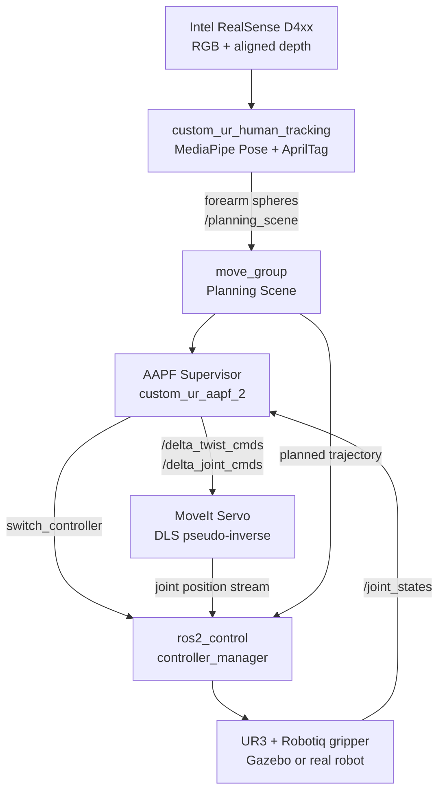
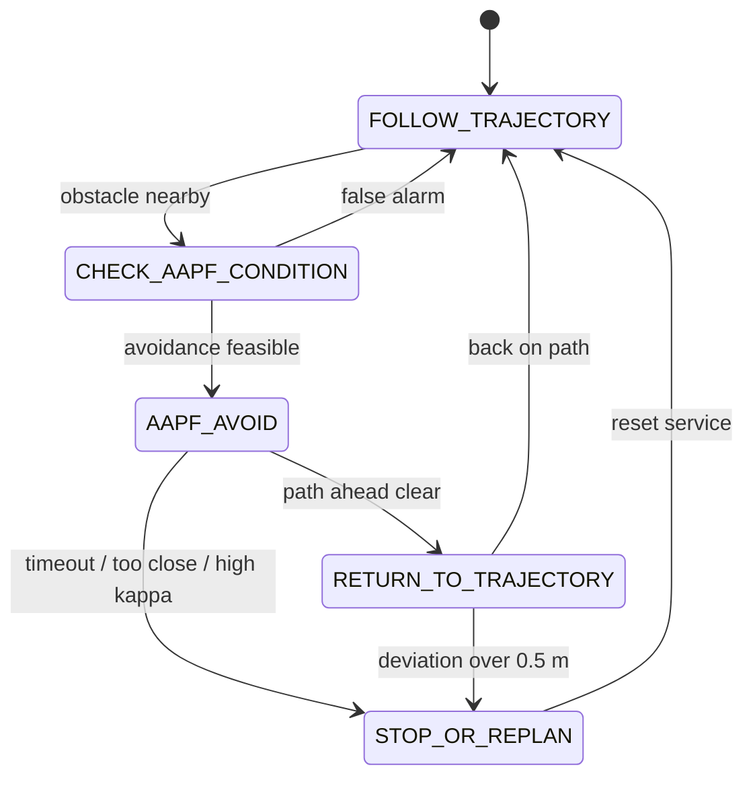

<div align="center">

# Real-Time Human-Aware Obstacle Avoidance for UR3

**Adaptive Artificial Potential Field (AAPF) + MoveIt Servo on ROS 2 Humble, in Gazebo and on a real UR3 robot**


**English** | [Tiếng Việt](README.vi.md)

</div>

---

## Overview

A UR3 arm follows a trajectory planned by MoveIt. A depth camera tracks a person's forearm and adds it to the planning scene as collision spheres. When an obstacle gets too close, a supervisor running a state machine stops following the trajectory and steers the end-effector around the obstacle with an **adaptive potential field**, streamed through **MoveIt Servo**. Once the path is clear, the arm goes back to its original trajectory. If it cannot avoid the obstacle safely, it stops.

The same source code runs in **Gazebo simulation** and on the **physical robot**. Only the launch and config files differ.

## Key Features

- **Reactive AAPF avoidance.** An attractive force pulls the end-effector toward the trajectory and a repulsive force pushes it away from obstacles. Both are combined into a Cartesian twist and sent to MoveIt Servo at about 100 Hz.
- **Supervisor state machine with five modes:** `FOLLOW`, `CHECK`, `AVOID`, `RETURN` and `STOP`, with timeouts and limits on distance, path deviation and singularity.
- **Singularity handling at two levels:**
  - The Jacobian pseudo-inverse in a forked `moveit_servo` uses adaptive **Damped Least Squares** instead of the standard one.
  - The supervisor watches the Jacobian condition number κ, with hysteresis. When κ gets too high, it switches from Cartesian twist commands to joint-space commands.
- **Live controller switching on real hardware.** The supervisor switches between `scaled_joint_trajectory_controller` (for following trajectories) and `forward_position_controller` (for servoing).
- **Human tracking with a camera.** The pipeline uses MediaPipe PoseLandmarker on RGB-D frames from an Intel RealSense. An AprilTag gives the camera-to-world calibration. The detected forearm is added to the MoveIt planning scene as collision spheres at about 15 Hz.
- **Experiment logging.** A CSV logger records 34 channels: FSM state, minimum distance, end-effector pose, joint positions and velocities, and camera skeleton data.
- **Testable design.** The control logic (FSM, AAPF, singularity handler) is pure C++ with no ROS dependency, kept apart from the ROS adapter node, and has unit tests.

## System Architecture



### Supervisor State Machine



## Tech Stack

| Area | Tools |
|---|---|
| Middleware | ROS 2 Humble, ros2_control, Universal Robots ROS 2 Driver |
| Motion | MoveIt 2 (OMPL, KDL), MoveIt Servo (forked, DLS patch) |
| Simulation | Gazebo Classic, RViz 2 |
| Perception | Intel RealSense, MediaPipe Tasks (PoseLandmarker), OpenCV, AprilTag 36h11 |
| Languages | C++17 (Eigen), Python 3.10 (NumPy) |
| Hardware | UR3, Robotiq 2F-85 / Hand-E gripper, RealSense depth camera |

## Repository Structure

| Package | Description |
|---|---|
| [`custom_ur_aapf_2`](custom_ur_aapf_2/) | AAPF supervisor: FSM, potential field, singularity handler, obstacle manager, joint velocity estimator |
| [`custom_ur_servo`](custom_ur_servo/) | MoveIt Servo host node with sim and real configs |
| [`custom_ur_human_tracking`](custom_ur_human_tracking/) | Forearm tracking with RealSense and MediaPipe, plus a bridge that adds the forearm to the planning scene |
| [`custom_ur_simulation`](custom_ur_simulation/) | Bringup launch files: Gazebo or the real UR driver, plus move_group and RViz |
| [`custom_ur_description`](custom_ur_description/) | URDF/xacro and meshes for UR3, Robotiq grippers and camera |
| [`ur3_moveit_config`](ur3_moveit_config/) | MoveIt configuration (kinematics, joint limits, controllers) |
| [`custom_ur_logger`](custom_ur_logger/) | CSV experiment logger |
| [`custom_ur_teleop`](custom_ur_teleop/) | Keyboard teleoperation for Servo |
| [`third_party/moveit_servo`](third_party/moveit_servo/) | Forked `moveit_servo` with the DLS patch ([PATCHES.md](third_party/moveit_servo/PATCHES.md)) |

## Getting Started

### Prerequisites

- Ubuntu 22.04 with ROS 2 Humble
- MoveIt 2, ros2_control, gazebo_ros, `ur_robot_driver`, `ur_description`, `robotiq_description`
- `ros-humble-realsense2-camera`
- Python packages: `mediapipe` 0.10.x, `opencv-python`, `numpy`

### Build

```bash
mkdir -p ~/ur_ws && cd ~/ur_ws
git clone <this-repo-url> src
rosdep install --from-paths src --ignore-src -r -y
colcon build --symlink-install
source install/setup.bash
```

> [!NOTE]
> Check that the workspace uses the patched Servo: `ros2 pkg prefix moveit_servo` should point inside `~/ur_ws/install`.

### Run in Simulation

```bash
# Terminal 1: Gazebo + MoveIt + RViz
ros2 launch custom_ur_simulation spawn_moveit_camera_gripper.launch.py with_gripper:=true

# Terminal 2: MoveIt Servo
ros2 launch custom_ur_servo spawn_moveit_servo_2.launch.py with_gripper:=true

# Terminal 3: AAPF supervisor
ros2 launch custom_ur_aapf_2 aapf_supervisor.launch.py
ros2 service call /aapf_supervisor/start std_srvs/srv/Trigger {}

# Terminal 4: plan and execute a trajectory in RViz, then spawn a test obstacle
ros2 service call /obstacle_manager/spawn std_srvs/srv/Trigger {}
ros2 topic echo /aapf_supervisor/mode_text
```

### Run on the Real Robot

```bash
# Terminal 1: UR driver + move_group (then press Play on "External Control" in the pendant)
ros2 launch custom_ur_simulation bringup_real_camera_gripper.launch.py robot_ip:=<ROBOT_IP>

# Terminal 2: MoveIt Servo
ros2 launch custom_ur_servo spawn_moveit_servo_real.launch.py
ros2 service call /custom_moveit_servo/start_servo std_srvs/srv/Trigger {}

# Terminal 3: AAPF supervisor (loads aapf_params_real.yaml)
ros2 launch custom_ur_aapf_2 aapf_supervisor_real.launch.py
ros2 service call /aapf_supervisor/start std_srvs/srv/Trigger {}

# Terminal 4: RealSense camera + human tracking
ros2 launch realsense2_camera rs_launch.py align_depth.enable:=true pointcloud.enable:=false
ros2 launch custom_ur_human_tracking human_tracking.launch.py
```

> [!WARNING]
> Start with a low speed slider on the pendant (10 to 20 percent). Do not load `aapf_params_real.yaml` in simulation, because it turns on controller switching to controllers that do not exist in Gazebo.

**Calibration.** Put a 9 cm AprilTag (family 36h11) in view of the camera, then hold a T-pose until the overlay shows that calibration is done. After that, the forearm is tracked and added to the planning scene as collision spheres.

<details>
<summary><b>Logging and diagnostics</b></summary>

```bash
# CSV logger (default output: ~/aapf_logs, 50 Hz)
ros2 launch custom_ur_logger logger.launch.py
ros2 service call /human_aapf_logger/start std_srvs/srv/Trigger {}
ros2 service call /human_aapf_logger/stop  std_srvs/srv/Trigger {}

# Recover from STOP
ros2 service call /aapf_supervisor/reset std_srvs/srv/Trigger {}
```

| Topic | Description |
|---|---|
| `/aapf_supervisor/mode_text` | Current FSM state |
| `/aapf_supervisor/obstacle_distance` | Minimum distance between robot and obstacle |
| `/aapf_supervisor/condition_number` | Jacobian condition number (kappa) |
| `/aapf_supervisor/ee_speed` | End-effector speed |
| `/arm_joint_velocities` | Estimated joint velocities |
| `/human_skeleton` | Elbow and wrist poses in the world frame |

See [run_commands.md](run_commands.md) for the full list of commands.

</details>

## Documentation

Design notes, in Vietnamese, are in [`custom_ur_aapf_2/docs`](custom_ur_aapf_2/docs/):

- [System overview](custom_ur_aapf_2/docs/he_thong_tong_quan.md)
- [MoveIt Servo and controller switching](custom_ur_aapf_2/docs/moveit_servo_va_doi_controller.md)
- [Supervisor FSM explained](custom_ur_aapf_2/docs/supervisor_giai_thich.md)
- [Re-IK resume integration](custom_ur_aapf_2/docs/approach3_reik_resume_integration.md)

## Author

**Nguyen Thanh Dat**, GitHub [@datnguyen1119](https://github.com/datnguyen1119)
