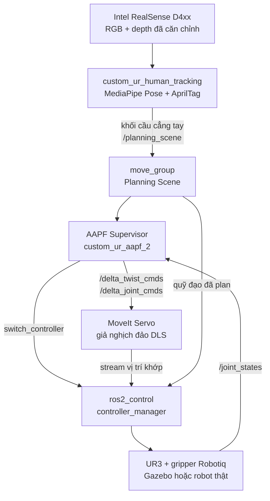
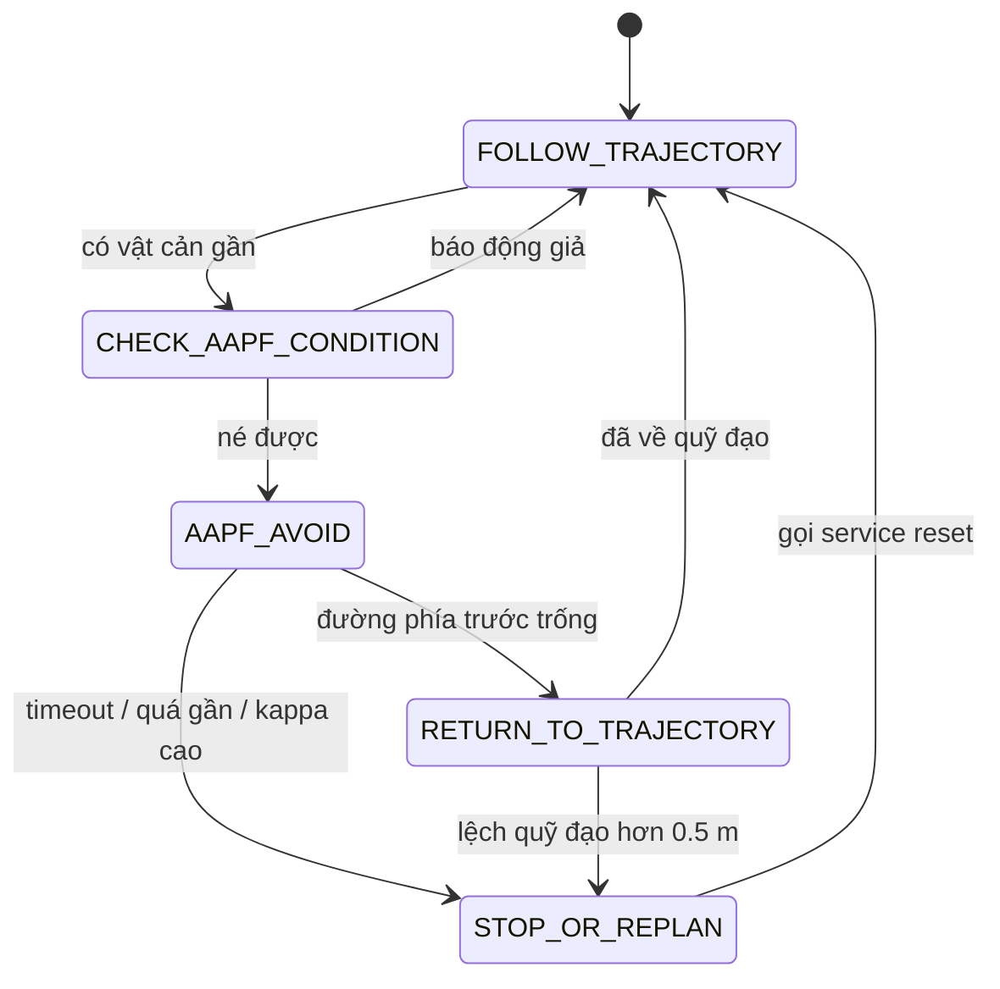

<div align="center">

# Né vật cản thời gian thực có nhận diện người cho UR3

**Trường thế năng thích nghi (AAPF) + MoveIt Servo trên ROS 2 Humble, chạy được trên Gazebo và robot UR3 thật**


[English](README.md) | **Tiếng Việt**

</div>

---

## Tổng quan

Cánh tay UR3 chạy theo quỹ đạo do MoveIt lập kế hoạch. Camera chiều sâu theo dõi cẳng tay người và đưa cẳng tay vào planning scene dưới dạng các khối cầu va chạm. Khi vật cản tiến quá gần, một supervisor (máy trạng thái) tạm dừng việc bám quỹ đạo và lái end-effector đi vòng qua vật cản bằng **trường thế năng thích nghi**, gửi lệnh qua **MoveIt Servo**. Khi đường đi đã thông, robot quay lại quỹ đạo ban đầu. Nếu không né được an toàn, robot dừng lại.

**Mô phỏng Gazebo** và **robot thật** dùng chung toàn bộ mã nguồn, chỉ khác nhau ở file launch và config.

## Tính năng chính

- **Né vật cản phản ứng bằng AAPF.** Lực hút kéo end-effector về phía quỹ đạo, lực đẩy đẩy nó ra xa vật cản. Hai lực được gộp thành một twist Cartesian và gửi tới MoveIt Servo ở khoảng 100 Hz.
- **Supervisor dạng FSM 5 trạng thái:** `FOLLOW`, `CHECK`, `AVOID`, `RETURN` và `STOP`, có timeout cùng các ngưỡng về khoảng cách, độ lệch quỹ đạo và singularity.
- **Xử lý singularity ở hai lớp:**
  - Trong bản fork của `moveit_servo`, giả nghịch đảo Jacobian dùng **Damped Least Squares** thích nghi thay cho cách tính gốc.
  - Supervisor theo dõi số điều kiện κ của Jacobian, có hysteresis. Khi κ quá cao, supervisor chuyển từ lệnh twist Cartesian sang lệnh trong không gian khớp.
- **Đổi controller trực tiếp trên robot thật.** Supervisor chuyển qua lại giữa `scaled_joint_trajectory_controller` (để bám quỹ đạo) và `forward_position_controller` (để servo).
- **Nhận diện người bằng camera.** Pipeline chạy MediaPipe PoseLandmarker trên ảnh RGB-D từ Intel RealSense. Mã AprilTag dùng để hiệu chuẩn từ camera sang hệ tọa độ world. Cẳng tay được đưa vào planning scene của MoveIt dưới dạng các khối cầu va chạm ở khoảng 15 Hz.
- **Ghi log thí nghiệm.** Logger CSV ghi 34 cột: trạng thái FSM, khoảng cách nhỏ nhất, vị trí end-effector, vị trí và vận tốc khớp, dữ liệu khung xương từ camera.
- **Thiết kế dễ kiểm thử.** Phần logic điều khiển (FSM, AAPF, xử lý singularity) viết bằng C++ thuần, không phụ thuộc ROS, tách riêng khỏi node adapter ROS và có unit test.

## Kiến trúc hệ thống



### Máy trạng thái của Supervisor



## Công nghệ sử dụng

| Mảng | Công cụ |
|---|---|
| Middleware | ROS 2 Humble, ros2_control, Universal Robots ROS 2 Driver |
| Chuyển động | MoveIt 2 (OMPL, KDL), MoveIt Servo (bản fork có patch DLS) |
| Mô phỏng | Gazebo Classic, RViz 2 |
| Thị giác | Intel RealSense, MediaPipe Tasks (PoseLandmarker), OpenCV, AprilTag 36h11 |
| Ngôn ngữ | C++17 (Eigen), Python 3.10 (NumPy) |
| Phần cứng | UR3, gripper Robotiq 2F-85 / Hand-E, camera chiều sâu RealSense |

## Cấu trúc repo

| Package | Mô tả |
|---|---|
| [`custom_ur_aapf_2`](custom_ur_aapf_2/) | AAPF supervisor: FSM, trường thế năng, xử lý singularity, quản lý vật cản, ước lượng vận tốc khớp |
| [`custom_ur_servo`](custom_ur_servo/) | Node host MoveIt Servo, kèm config cho sim và real |
| [`custom_ur_human_tracking`](custom_ur_human_tracking/) | Theo dõi cẳng tay bằng RealSense và MediaPipe, kèm bridge đưa cẳng tay vào planning scene |
| [`custom_ur_simulation`](custom_ur_simulation/) | File launch bringup: Gazebo hoặc driver UR thật, cùng move_group và RViz |
| [`custom_ur_description`](custom_ur_description/) | URDF/xacro và mesh cho UR3, gripper Robotiq và camera |
| [`ur3_moveit_config`](ur3_moveit_config/) | Cấu hình MoveIt (kinematics, giới hạn khớp, controller) |
| [`custom_ur_logger`](custom_ur_logger/) | Logger CSV cho thí nghiệm |
| [`custom_ur_teleop`](custom_ur_teleop/) | Điều khiển Servo bằng bàn phím |
| [`third_party/moveit_servo`](third_party/moveit_servo/) | Bản fork `moveit_servo` có patch DLS ([PATCHES.md](third_party/moveit_servo/PATCHES.md)) |

## Hướng dẫn cài đặt và chạy

### Yêu cầu

- Ubuntu 22.04, ROS 2 Humble
- MoveIt 2, ros2_control, gazebo_ros, `ur_robot_driver`, `ur_description`, `robotiq_description`
- `ros-humble-realsense2-camera`
- Thư viện Python: `mediapipe` 0.10.x, `opencv-python`, `numpy`

### Build

```bash
mkdir -p ~/ur_ws && cd ~/ur_ws
git clone <this-repo-url> src
rosdep install --from-paths src --ignore-src -r -y
colcon build --symlink-install
source install/setup.bash
```

> [!NOTE]
> Kiểm tra workspace đang dùng bản Servo đã patch: lệnh `ros2 pkg prefix moveit_servo` phải trả về đường dẫn nằm trong `~/ur_ws/install`.

### Chạy mô phỏng

```bash
# Terminal 1: Gazebo + MoveIt + RViz
ros2 launch custom_ur_simulation spawn_moveit_camera_gripper.launch.py with_gripper:=true

# Terminal 2: MoveIt Servo
ros2 launch custom_ur_servo spawn_moveit_servo_2.launch.py with_gripper:=true

# Terminal 3: AAPF supervisor
ros2 launch custom_ur_aapf_2 aapf_supervisor.launch.py
ros2 service call /aapf_supervisor/start std_srvs/srv/Trigger {}

# Terminal 4: plan và execute một quỹ đạo trong RViz, rồi thả vật cản test
ros2 service call /obstacle_manager/spawn std_srvs/srv/Trigger {}
ros2 topic echo /aapf_supervisor/mode_text
```

### Chạy robot thật

```bash
# Terminal 1: driver UR + move_group (sau đó bấm Play "External Control" trên pendant)
ros2 launch custom_ur_simulation bringup_real_camera_gripper.launch.py robot_ip:=<ROBOT_IP>

# Terminal 2: MoveIt Servo
ros2 launch custom_ur_servo spawn_moveit_servo_real.launch.py
ros2 service call /custom_moveit_servo/start_servo std_srvs/srv/Trigger {}

# Terminal 3: AAPF supervisor (tự nạp aapf_params_real.yaml)
ros2 launch custom_ur_aapf_2 aapf_supervisor_real.launch.py
ros2 service call /aapf_supervisor/start std_srvs/srv/Trigger {}

# Terminal 4: camera RealSense + nhận diện người
ros2 launch realsense2_camera rs_launch.py align_depth.enable:=true pointcloud.enable:=false
ros2 launch custom_ur_human_tracking human_tracking.launch.py
```

> [!WARNING]
> Để speed slider trên pendant ở mức thấp (10 đến 20%). Không nạp `aapf_params_real.yaml` khi chạy mô phỏng, vì file này bật đổi controller sang các controller không có trong Gazebo.

**Hiệu chuẩn.** Đặt mã AprilTag 9 cm (họ 36h11) trong khung hình camera, rồi đứng T-pose cho tới khi màn hình báo đã hiệu chuẩn xong. Sau đó cẳng tay được theo dõi và đưa vào planning scene dưới dạng các khối cầu va chạm.

<details>
<summary><b>Ghi log và chẩn đoán</b></summary>

```bash
# Logger CSV (mặc định lưu vào ~/aapf_logs, 50 Hz)
ros2 launch custom_ur_logger logger.launch.py
ros2 service call /human_aapf_logger/start std_srvs/srv/Trigger {}
ros2 service call /human_aapf_logger/stop  std_srvs/srv/Trigger {}

# Khôi phục sau STOP
ros2 service call /aapf_supervisor/reset std_srvs/srv/Trigger {}
```

| Topic | Mô tả |
|---|---|
| `/aapf_supervisor/mode_text` | Trạng thái FSM hiện tại |
| `/aapf_supervisor/obstacle_distance` | Khoảng cách nhỏ nhất giữa robot và vật cản |
| `/aapf_supervisor/condition_number` | Số điều kiện của Jacobian (kappa) |
| `/aapf_supervisor/ee_speed` | Tốc độ end-effector |
| `/arm_joint_velocities` | Vận tốc khớp ước lượng |
| `/human_skeleton` | Vị trí khuỷu tay và cổ tay trong hệ world |

Danh sách lệnh đầy đủ có trong [run_commands.md](run_commands.md).

</details>

## Tài liệu

Ghi chú thiết kế chi tiết nằm trong [`custom_ur_aapf_2/docs`](custom_ur_aapf_2/docs/):

- [Tổng quan hệ thống](custom_ur_aapf_2/docs/he_thong_tong_quan.md)
- [MoveIt Servo và đổi controller](custom_ur_aapf_2/docs/moveit_servo_va_doi_controller.md)
- [Giải thích FSM của supervisor](custom_ur_aapf_2/docs/supervisor_giai_thich.md)
- [Tích hợp re-IK khi quay lại quỹ đạo](custom_ur_aapf_2/docs/approach3_reik_resume_integration.md)

## Tác giả

**Nguyễn Thành Đạt**, GitHub [@datnguyen1119](https://github.com/datnguyen1119)
